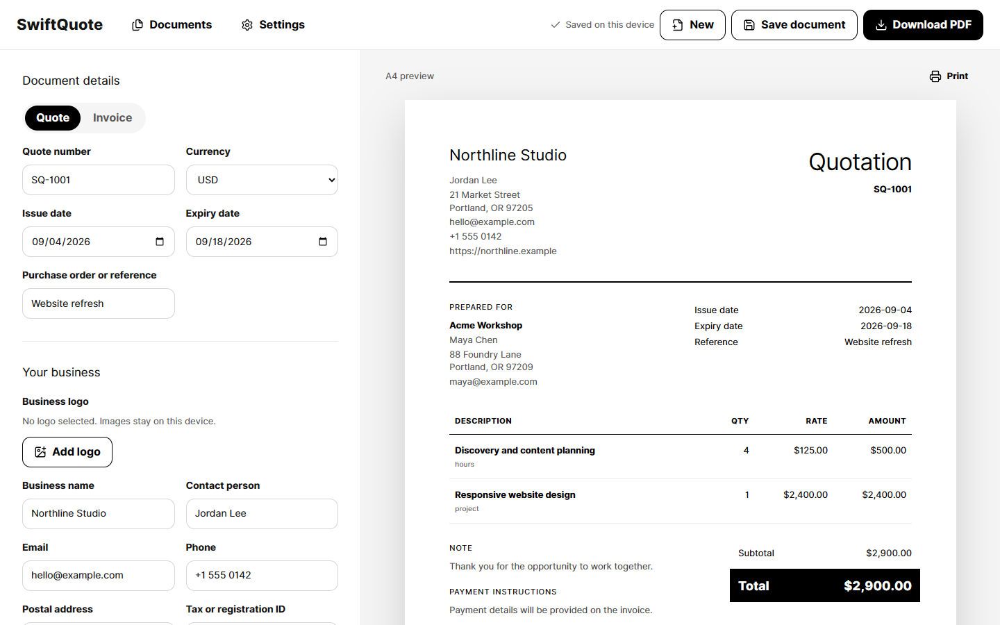

# SwiftQuote

SwiftQuote is a local-first quote and invoice builder for freelancers, consultants, contractors, and small service businesses. It creates accurate client documents in the browser without accounts, analytics, or a backend.

[Open SwiftQuote](https://gettlink.github.io/swiftquote/)



## What it does

- Creates quotes and invoices from a realistic sample or a blank document.
- Edits business details, customer details, dates, references, line items, discounts, tax, fees, notes, terms, and payment information.
- Calculates totals with integer minor units and basis-point rates to avoid floating-point money errors.
- Supports USD, KES, EUR, GBP, NGN, ZAR, CAD, AUD, INR, JPY, and AED formatting.
- Switches between Modern and Classic document templates without changing the underlying data.
- Previews A4 and US Letter output with explicit page boundaries.
- Downloads searchable PDFs entirely in the browser.
- Autosaves work locally and restores it after a refresh.
- Manages saved documents with duplicate, quote-to-invoice conversion, delete, and undo actions.
- Imports and exports versioned JSON backups with strict runtime validation.
- Accepts PNG, JPEG, and WebP logos, validates their content, removes metadata through browser re-encoding, and keeps them on the device.

## Privacy

SwiftQuote does not send document data to a server. It has no telemetry, tracking, remote logging, external fonts, or third-party document processing. Documents and settings are stored in IndexedDB in the current browser profile.

Browser storage is not a substitute for a backup. Export a JSON copy of important records before clearing site data or changing devices.

## Calculation model

Financial calculations are isolated from the interface and use deterministic integer arithmetic:

1. Parse each unit price into currency minor units.
2. Parse quantity into a fixed-scale integer.
3. Round each line total using half-up rounding.
4. Calculate discount, tax, and fees in the documented order.
5. Derive the final total and balance from validated inputs.

Imported totals are never trusted. SwiftQuote validates the source fields and recalculates every derived value.

## Technology

- React 19 and strict TypeScript
- Vite and Tailwind CSS
- Zod runtime validation
- React PDF for client-side PDF generation
- IndexedDB with an in-memory resilience fallback
- Vitest and React Testing Library
- Playwright for browser and PDF workflows
- GitHub Actions and GitHub Pages

## Run locally

Requirements: Node.js 22 or newer and npm.

```bash
git clone https://github.com/gettlink/swiftquote.git
cd swiftquote
npm ci
npm run dev
```

Vite prints the local URL when the development server starts.

## Verification

| Command | Purpose |
| --- | --- |
| `npm run typecheck` | Check the strict TypeScript project. |
| `npm run test` | Run domain, schema, storage, and component tests. |
| `npm run audit` | Check the visual palette and prohibited copy patterns. |
| `npm run build` | Create the production static bundle. |
| `npm run test:e2e` | Run complete Chromium workflows and generate PDF fixtures. |
| `npm run check` | Run type checking, unit tests, the product audit, and the production build. |

The browser suite covers document creation, persistence, quote conversion, delete recovery, settings, JSON backup and restore, malformed imports, A4 and US Letter PDF generation, long-document pagination, keyboard operation, and responsive widths from 375 to 1440 CSS pixels.

## Project structure

```text
src/
  app/                 Application shell and workflows
  components/          Accessible shared controls
  domain/              Money, quantity, numbering, and totals
  features/            Editor, preview, documents, import, and settings
  pdf/                 Searchable A4 and US Letter PDF generation
  schemas/             Runtime validation and versioned data contracts
  storage/             IndexedDB repository, migrations, and autosave
e2e/                   Complete browser workflows
.github/workflows/     Pull-request verification and Pages deployment
```

## Repository protection

Changes to `main` use pull requests with a required verification workflow and review. Stale reviews are dismissed, unresolved conversations block merging, linear history is required, and force pushes and branch deletion are disabled. GitHub dependency alerts and automated security fixes are enabled.

## Deployment

Every push to `main` runs the full release gate, builds the static application with the `/swiftquote/` base path, and deploys the resulting `dist` directory to GitHub Pages. The application has no server runtime.

## License

SwiftQuote is licensed under the [MIT License](LICENSE).
